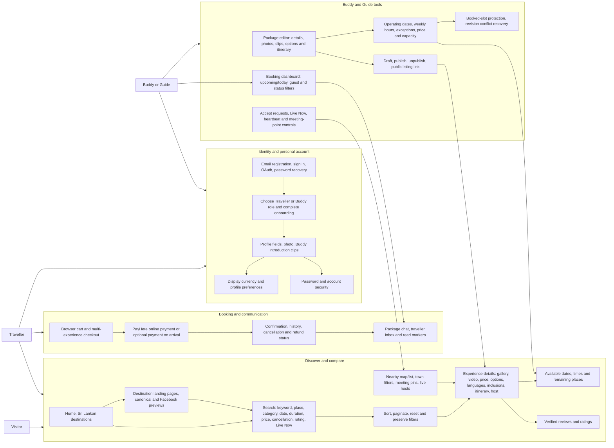
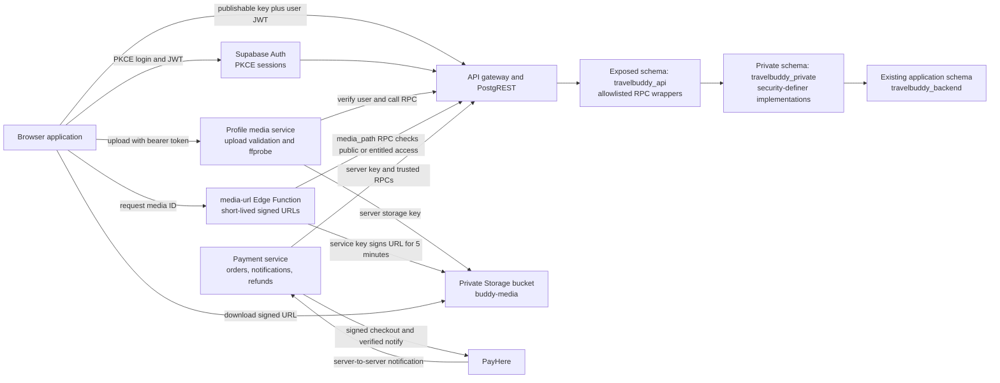
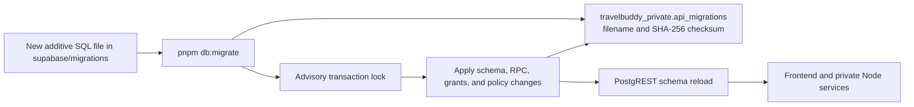

# TravelBuddy architecture

This page maps the user-facing features, the application runtime, and the Supabase boundary represented by this repository. The diagrams reflect the current code and manifests; they are not a claim that every production resource is managed here.

## Product functionality



The corresponding routes are defined in `src/routes/`: public routes include `/`, `/search`, `/destinations/:slug`, `/nearby`, `/experience/:id`, and `/buddy/:id`; authenticated routes include account/profile/package management, `/cart`, `/checkout`, bookings, confirmations, payments, and inbox. Route guards and page implementations live under `src/features/`.

## Kubernetes and application runtime

```mermaid
flowchart LR
  git[GitHub main branch or manual workflow run]
  build[Build Vite assets and runtime image]
  ghcr[GHCR image tagged with commit SHA]
  ingress[Public HTTPS ingress or reverse proxy<br/>configured outside these manifests]

  subgraph cluster[Kubernetes cluster]
    subgraph appns[Namespace: travelbuddy]
      svc[Service travelbuddy<br/>ClusterIP port 80]
      deploy[Deployment travelbuddy<br/>1 replica in checked-in manifest]
      subgraph pod[Pod: app container, port 8080]
        runtime[Node runtime server<br/>serves dist and proxies service paths]
        media[Profile media service<br/>127.0.0.1:5174]
        payments[Payment service<br/>127.0.0.1:5175]
        runtime -->|/profile-media/*| media
        runtime -->|/payments-api/*| payments
      end
      secret[Secret travelbuddy-runtime<br/>keys and optional PayHere credentials]
      svc --> deploy --> pod
      secret -. injected environment .-> pod
    end
    subgraph supns[Namespace: supabase, separately managed]
      envoy[Service supabase-envoy<br/>port 8000]
      supastack[Existing self-hosted Supabase stack]
      envoy --> supastack
    end
  end

  git --> build --> ghcr
  ghcr -. image reference in deployment.yaml .-> deploy
  ingress --> svc
  runtime -->|SUPABASE_URL internal service DNS| envoy
  payments -->|server RPCs| envoy
  media -->|verified RPCs and storage| envoy
  browser[Browser] -->|built-in public URL and publishable key| supastack
  payhere[PayHere callback] -->|HTTPS /payments-api/notify| ingress
```

### What the Kubernetes manifests configure

- `k8s/namespace.yaml` creates the `travelbuddy` namespace.
- `k8s/deployment.yaml` runs one app replica from `ghcr.io/tonyroyze/travelbuddy-refactor:<commit-sha>`. Replace the image placeholder and public hostname placeholders before applying it. It references the `travelbuddy-runtime` Secret for the Supabase publishable, secret, and optional storage keys, plus optional PayHere credentials.
- `k8s/service.yaml` exposes the pod internally as a `ClusterIP` Service on port 80, targeting the container's named HTTP port 8080.
- The runtime image's `services/runtime/server.mjs` serves the built SPA, starts the profile-media and payment Node services in the same container, and proxies `/profile-media/` and `/payments-api/` to their loopback ports. `/healthz` backs the deployment's readiness and liveness probes.
- `.github/workflows/publish-image.yml` builds and pushes a SHA-tagged image to GHCR on `main` or a manual run. It passes the public Supabase URL, publishable key, and site URL at build time. These browser values are not secrets. The workflow does not apply Kubernetes manifests.
- No Ingress, TLS, autoscaler, or Supabase workload manifest is included in `k8s/`. A public ingress/reverse proxy and its callback routing must be supplied by the cluster installation. Supabase runs in its separate `supabase` namespace and is reached by the app pod through `supabase-envoy.supabase.svc.cluster.local:8000`.

The static browser bundle uses the public Supabase URL and publishable key compiled at build time. Server-side services use `SUPABASE_URL` from the Deployment environment, which points at the in-cluster Envoy service. Changing the public origin requires rebuilding the frontend; changing server credentials requires updating the Kubernetes Secret and restarting the pod.

## Supabase API, data, and security



### Supabase setup and trust boundaries

- This application extends an existing self-hosted Supabase installation; the checked-in SQL migrations are additive and do not create an empty Supabase database. The local Compose override in `infra/supabase/docker-compose.travelbuddy.yml` expects the upstream Supabase Compose stack and limits its API gateway and database-pooler port bindings to loopback.
- PostgREST exposes `travelbuddy_api`, the RPC surface used by the browser and server services. Keep `travelbuddy_private` and the existing `travelbuddy_backend` schema out of the exposed-schema list. The migration setup grants API schema usage, revokes broad function execution defaults, and installs explicit grants for wrappers.
- Private SQL functions use fixed search paths and restricted security-definer execution. A dedicated `NOLOGIN`, `NOBYPASSRLS` role has only the required application-table privileges. Browser roles cannot read or write private tables directly; write functions check the verified Supabase identity, account state, ownership, membership, and role.
- Supabase Auth supplies user identity and PKCE sessions. Add the exact deployed app callback URLs to Auth configuration. Password recovery also depends on working SMTP. OAuth provider credentials remain in Supabase Auth configuration, not in the browser bundle.
- The private `buddy-media` bucket stores profile and package media. Uploads go through the profile-media service, which verifies the JWT, checks account/package ownership and size/type limits, and can inspect videos with `ffprobe`. The `media-url` Edge Function asks the API whether a media ID is public or the caller is entitled to it, then returns a five-minute signed Storage URL.
- Payment writes and PayHere notification verification run in the private payment service. It verifies merchant/checksum/amount/currency before changing payment state. Supabase stores orders, booking snapshots, refunds, and cancellation policy; the browser return URL alone never marks an order paid.
- Supabase service, storage, and payment secrets are server-only. Only the publishable key and public URL are compiled into `VITE_` browser settings.

### Database migration path



The migration runner sorts SQL files, records checksums in a restricted journal, and uses a transaction advisory lock. It skips a migration only when its filename and checksum already match; applied migrations should not be edited. Run the migrations with an administrator that can create the required roles and grants before deploying app code. See [deployment notes](deployment.md), [feature audit](phase-one-feature-audit.md), [marketplace features](vidura-marketplace-features.md), and [nearby provider setup](nearby-live-providers.md) for operational details.
