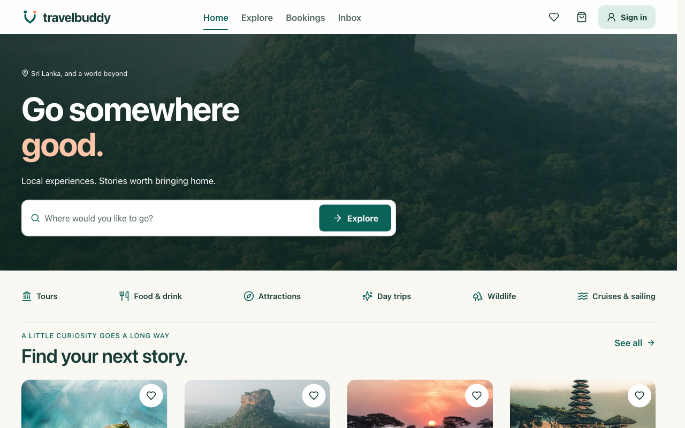
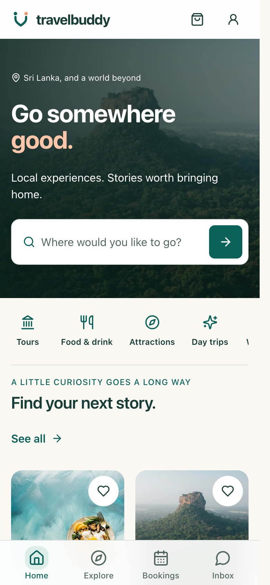
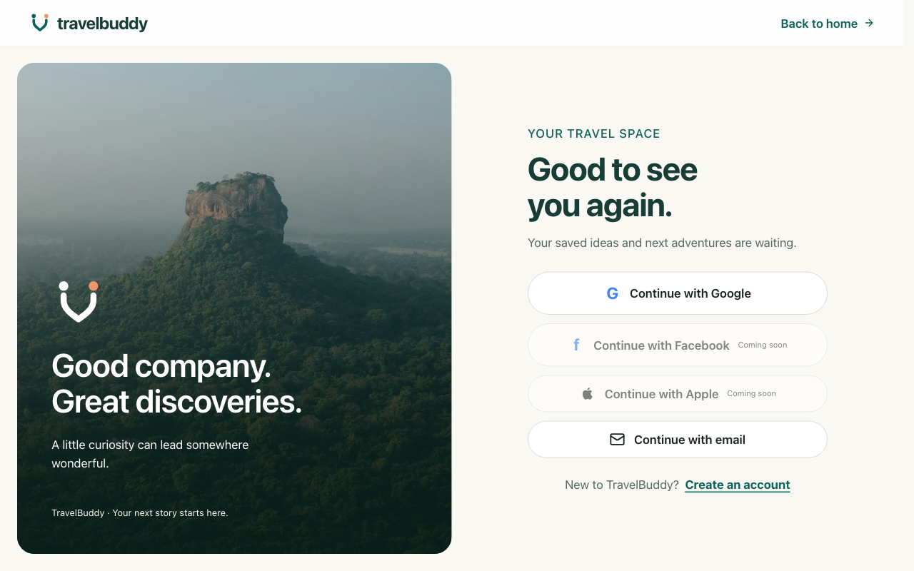
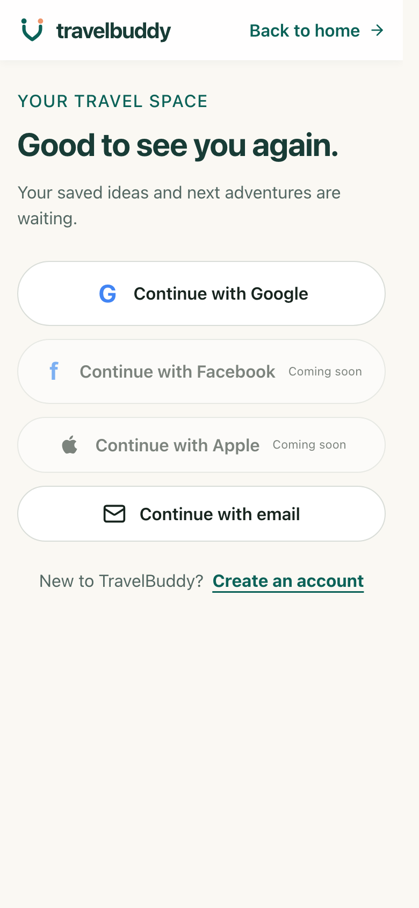
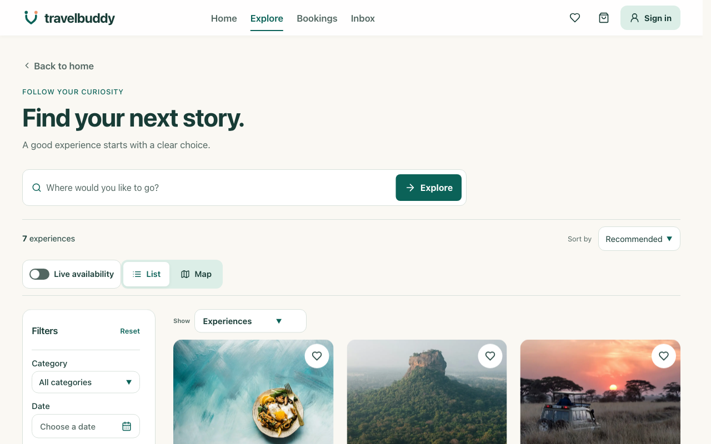
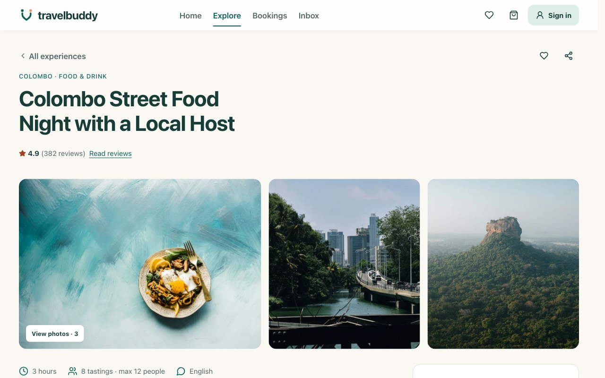

# Legacy UI reference screenshots

Captured from the original Next.js app at `http://localhost:3000` on 16 October 2026. Desktop captures use a 1280×800 CSS-pixel viewport; mobile captures use 390×844. These are reference images from the old app, before recreating the same page in the Vite app.

## Home

## Sign in

## Explore and experience pages

